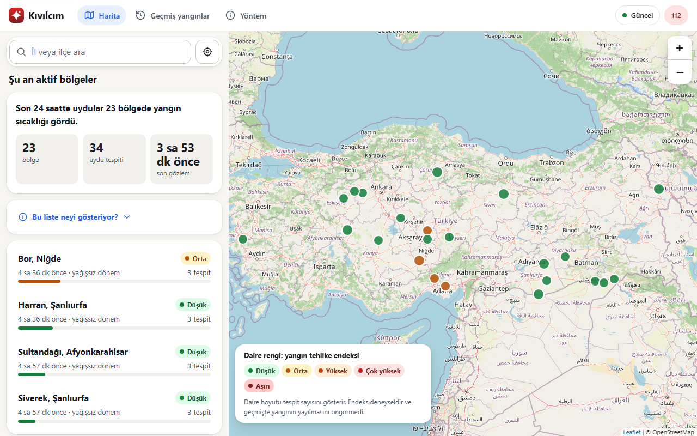
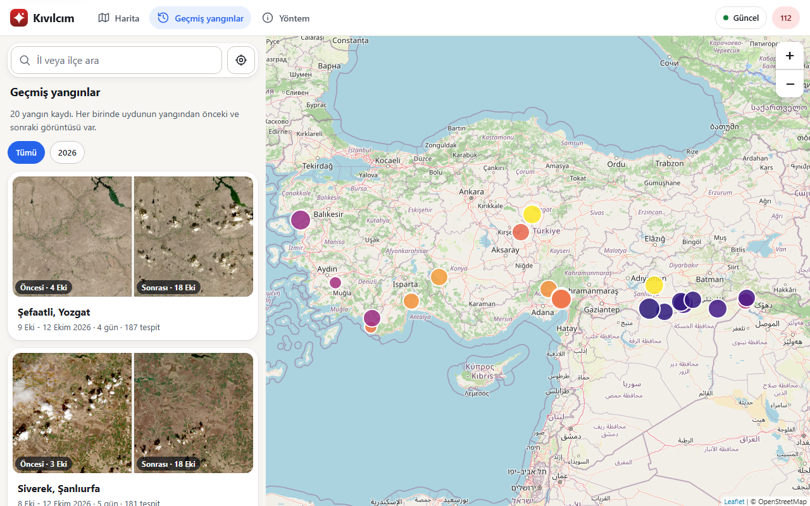
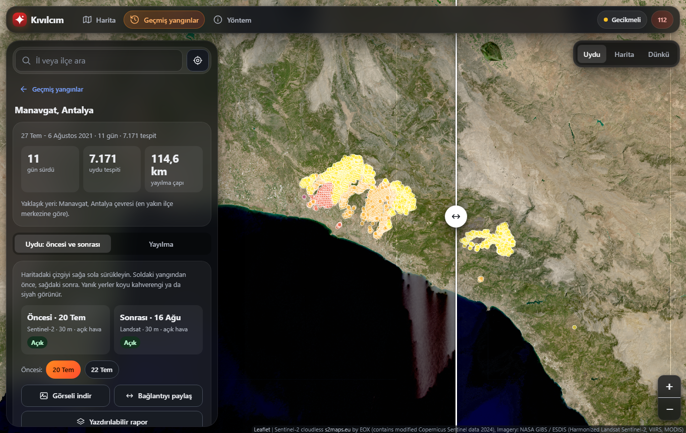

# Kıvılcım

[](https://github.com/beyuphan/kivilcim/actions/workflows/ci.yml)

Kıvılcım ("spark") shows wildfire detections in Turkey from NASA FIRMS satellite data. For any place it
lists nearby detections with when they were observed and how fresh the data is, and around active
detections it shows how favorable the weather is for fire. The site is in Turkish; this README and the
code are in English, and [PLAN.md](PLAN.md) is bilingual.

> **Not an official warning system.** Satellite detections can be delayed, can include false positives
> (factories, flares, crop burning) and do not show every fire; a small fire such as a house fire is
> usually not seen at all. In an emergency call **112** and contact **AFAD** in Turkey.



## Who it is for, and why use it

NASA's own FIRMS site shows the same detections, but as raw dots with English terms, and the forest
service's tools are made for firefighters. Kıvılcım is made for **people who live, farm or holiday near
wooded land** and want a plain answer in Turkish, and for **people who need to see what a fire did**:

- **"Is there a fire near me?"** Search a district or use your location: the detections within a radius,
  how old they are, and how old the data itself is. The answer says what it cannot know (a satellite passes a
  few times a day, small fires are missed).
- **"Did a satellite even look?"** "No detection" only means something if a satellite scanned the place. Every
  place shows how many times the five fire satellites scanned it in the last 24 hours, when the last and the
  next scan are, and the longest gap with none. Predicted from public orbit data and checked against real
  detections (99 % of 600 detections fell inside the modeled swath).
- **"Is it coming toward me?"** When a fire is near a place, the page compares the wind (direction and
  speed, from Open-Meteo) with where the nearest detection is: wind blowing from the fire toward you, across,
  or away. It draws the line to the fire and lists the district centers around it with the same wind check.
  This is plain geometry on the wind right now, not a spread forecast, and it says so.
- **"My places."** Save the village house, the field, the summer cottage. The home page shows each one with
  what the satellites saw within 10 km in the last day. The list stays in your browser; there are no accounts.
- **"Did it burn?"** Give any place and the dates of a fire and see the 30 m satellite image from before
  and from after, side by side, with clouds filtered out. Burn scars show as dark brown. Useful for owners,
  villagers, insurers' first look, journalists and volunteers. The dates are suggested from what the
  satellites saw nearby.
- **"Is that smoke or cloud?"** A Harita/Uydu switch puts yesterday's satellite picture of the whole region
  on the map, so you can tell for yourself.
- **Past fires** with the same before and after, to see how big fires of this season really were.

It is **not** an alarm: data arrives hours late and some fires never show. It does not replace 112.

## What it does

- **Active zones across Turkey.** The detections of the last day, grouped by place, on a map. The colour
  of a zone is the weather index at its center (experimental, see below); the size is its total heat power.
- **Any place.** Choose a province or district, click the map, or use your location, and see the
  detections within 10 to 500 km with observation time, confidence, satellite and distance, plus the
  current weather there. Places can be shared as links (`/?lat=39.9&lon=32.85&r=50`).
- **Honest about freshness.** Two times are shown and never mixed up: when the service last fetched data
  and when a satellite last observed the area. Hours between satellite passes are normal.
- **Weaker evidence is shown, not hidden.** Low-confidence detections and places that detect almost every
  day (probably a factory, refinery, flare or landfill) are drawn as hollow rings and listed apart.
- **Past fires** (`/history`). The big fires found in the satellite archive, each with the satellite
  image **before and after** it on one map (drag the line), and a day-by-day map of how the detections
  spread. Images come from NASA GIBS: 30 m Sentinel-2 and Landsat when a clear day exists, the 250 m daily
  VIIRS image otherwise, always labeled with their date, source and cloud cover.
- **Methodology** (`/methodology`). The data, formulas, thresholds, licenses, privacy and limits, and the
  results of measuring the weather index against past detections.
- **Installable and offline-aware.** Works on phones, installs as an app, and never shows stored data as if
  it were current.
- **An API** for developers: read-only, free, documented at `/docs`.





### About the weather index

For an active detection the weather index combines humidity, wind and the last 72 hours of rain into a
score, scaled by temperature (cold air keeps it low). It is **experimental** and says how favorable the
weather is for fire. It is **not** a spread forecast and not a probability.

It was measured against past detections (see `/methodology`): it only weakly separates places with fire
from places without (AUC about 0.7), and it showed **no relation** with whether a fire continues or grows
the next day. So it is presented as a rough indicator of fire weather only. The measurement is repeatable
(`python -m kivilcim.validate`) and the formula was not tuned on that data.

## Quick start

You need Python 3.11 or newer and a free NASA FIRMS key
([request one](https://firms.modaps.eosdis.nasa.gov/api/map_key/); it arrives by email).

```bash
git clone https://github.com/beyuphan/kivilcim.git
cd kivilcim
python -m venv .venv
.venv/Scripts/activate            # Windows. On Linux/macOS: source .venv/bin/activate
pip install -e ".[dev]"
cp .env.example .env              # Windows: copy .env.example .env   then put your key in .env
python -m kivilcim
```

Open http://localhost:8000/. That one command starts the site **and** a background timer that fetches
new detections every 30 minutes (and catches up after the computer was off). Stop it with Ctrl+C.

Useful options: `--port 9000`, `--host 0.0.0.0` (to share on your network), `--no-ingest` (only serve what
is stored), `--access-log` (log every request; off by default because addresses contain coordinates).

> **Windows note.** If Windows Application Control blocks SQLAlchemy's compiled extension
> (`DLL load failed ... _row_cy`), install it without the C extension:
> `set DISABLE_SQLALCHEMY_CEXT=1` then `pip install --force-reinstall --no-deps --no-binary sqlalchemy sqlalchemy`.

### Load the past months (for the "past fires" page)

FIRMS answers at most 5 days per request, so history is loaded in windows. Use the archive product (`_SP`)
for older dates and the near-real-time one (`_NRT`) for roughly the last three months:

```bash
python -m kivilcim.ingest --source VIIRS_SNPP_SP   --from 2026-06-01 --to 2026-07-31
python -m kivilcim.ingest --source VIIRS_SNPP_NRT  --from 2026-08-01 --to 2026-11-02
# the same for VIIRS_NOAA20_* and VIIRS_NOAA21_*
```

Backfills never touch the freshness shown for live data. To fetch once without the server:
`python -m kivilcim.ingest`.

## Configuration

Settings come from environment variables or a `.env` file ([.env.example](.env.example) lists all of them).

| Variable | Default | Meaning |
|---|---|---|
| `FIRMS_MAP_KEY` | none | NASA FIRMS key. Without it nothing new is fetched. |
| `DATABASE_URL` | `sqlite:///kivilcim.db` | Database. The code uses SQLite features. |
| `FIRMS_SOURCES` | three VIIRS + MODIS | Products to fetch. |
| `INGEST_INTERVAL_MINUTES` | `30` | Minutes between automatic fetches; `0` turns them off. |
| `OPEN_METEO_DAILY_QUOTA` | `7000` | Weather calls per day the server allows itself (a count, not money). |
| `WEATHER_CACHE_MINUTES` | `45` | How long a weather reading is reused per ~11 km cell. |
| `RATE_LIMIT_PER_MINUTE` | `120` | Requests per minute per client; `0` is unlimited. |
| `RATE_LIMIT_WEATHER_PER_MINUTE` | `30` | The same for requests that can call the weather provider. |
| `TRUST_PROXY` | `false` | Use `X-Forwarded-For` for the client address (only behind your own proxy). |
| `CORS_ORIGINS` | `*` | Sites allowed to call the API from a browser. |
| `TILE_URL`, `TILE_ATTRIBUTION` | OpenStreetMap | The map tiles. |

## Run with Docker

```bash
docker compose up -d        # reads .env, keeps the database in a volume
```

or `docker build -t kivilcim .` and `docker run -p 8000:8000 -e FIRMS_MAP_KEY=... -v kivilcim-data:/data kivilcim`.
The image runs `python -m kivilcim --host 0.0.0.0` as a normal user and has a health check on `/health`.
*(The image has not been built on the machine this version was prepared on; the Dockerfile follows the same
steps that were tested in a clean virtual environment. Please report any problem.)*

## Putting it online

The server is ready for public use, but a few things are yours to arrange:

1. **HTTPS.** Put a reverse proxy that provides it in front (Caddy, nginx, a hosting platform) and set
   `TRUST_PROXY=true` so each visitor gets their own rate limit. Installing the app and the service worker
   need HTTPS.
2. **Map tiles.** OpenStreetMap's public tile servers are for light use. For a busy site use a tile
   provider and set `TILE_URL` and `TILE_ATTRIBUTION`.
3. **Weather terms.** Open-Meteo's free tier is for **non-commercial** use and needs attribution (the pages
   already credit it). Ads, subscriptions or a paid API need a paid plan. Its limit is 10,000 calls a day;
   the server keeps its own lower quota, caches per ~11 km, and serves cached weather when it runs out.
4. **Backups.** The database is one SQLite file; back up the `/data` volume or `kivilcim.db`.
5. **Keep the disclaimers.** They are on every page and in every API response on purpose.

## API

Read-only JSON, free, no key. Interactive documentation at `/docs`. Times are UTC. Every response carries
a `disclaimer`; time-dependent ones carry `data_as_of`. Limits apply (see Configuration).

| Endpoint | Returns |
|---|---|
| `GET /health` | `{"status": "ok"}` |
| `GET /status` | Per-source last update and delay, `data_as_of`, the ingest interval and the weather quota used today. |
| `GET /fires?lat=&lon=&radius_km=&since_hours=` | Detections near a point, nearest first. Low-confidence and likely fixed sources are listed apart (`low_confidence`, `recurring_sources`). Radius 0-500 km, window 1-168 h. |
| `GET /weather?lat=&lon=` | Current weather for a point in Turkey (cached per ~11 km). |
| `GET /risk?lat=&lon=` | The experimental index for a point in Turkey, with the factors behind it. |
| `GET /risk/zones?since_hours=` | Active zones across Turkey, each with the index at its center. |
| `GET /events` and `GET /events/{id}` | Big fires found in the history, and the detections around one for a window before and after. |

```bash
curl "http://localhost:8000/fires?lat=37.3&lon=35.5&radius_km=100&since_hours=48"
```

## How it works

```
NASA FIRMS ──► ingest (every 30 min) ──► SQLite ◄── Open-Meteo (cached, batched)
                                            │
        zones · events · fixed sources ─────┤
                                            ▼
                              FastAPI  ──►  map site (Leaflet), /docs
```

| Module | Role |
|---|---|
| `firms`, `ingest`, `scheduler` | Parse and validate FIRMS CSV, store without duplicates, record each run, run on a timer. |
| `weather`, `risk` | Cached, quota-aware weather fetch and the index formula (v2). |
| `zones`, `events`, `fixed` | Group detections into active zones and past events; find always-on cells. |
| `api`, `security`, `ratelimit` | The routes and pages, headers and limits. |
| `validate`, `stats` | Measure the index against past detections. |
| `static/` | The pages, service worker, icons, district points and validation results. |

[PLAN.md](PLAN.md) records the design decisions and why; the `/methodology` page describes the behavior as the
site shows it.

## Data and licenses

- Fire detections: [NASA FIRMS](https://firms.modaps.eosdis.nasa.gov/) (open data).
- Weather: [Open-Meteo.com](https://open-meteo.com/), CC BY 4.0, free for non-commercial use.
- Map and district/province center points: © [OpenStreetMap](https://www.openstreetmap.org/copyright)
  contributors, ODbL 1.0 (the data files are in `data/`, with their own notice, apart from the MIT code).
- Map library: Leaflet (BSD-2).

## Development

```bash
pytest -q                          # the tests (no network needed)
ruff check src tests scripts       # lint
python -m kivilcim.districts data/turkiye-ilce-sinirlari_tm36.csv src/kivilcim/static/ilceler.json
python scripts/make_icons.py       # redraw the app icons (pure Python)
python -m kivilcim.validate --help # measure the index against past data (calls Open-Meteo's history API)
```

Tests are the specification: for example the numbers on the methodology page are checked against the code, so
the two cannot drift apart.

## Limits to keep in mind

- Detections are observation moments, not "burning now", and not fire perimeters.
- Small fires, short fires, and fires under cloud or heavy smoke are not seen.
- "Events" are grouped detections, not confirmed incidents, and some are crop burning.
- The weather index is a rough, experimental indicator, not a forecast (see above).
- History is VIIRS only and starts in June 2026; thresholds were chosen from that period.
- No information about firefighting or response is provided, and none is planned.

## License

MIT, see [LICENSE](LICENSE). The data under `data/` is ODbL, see [data/README.md](data/README.md).
